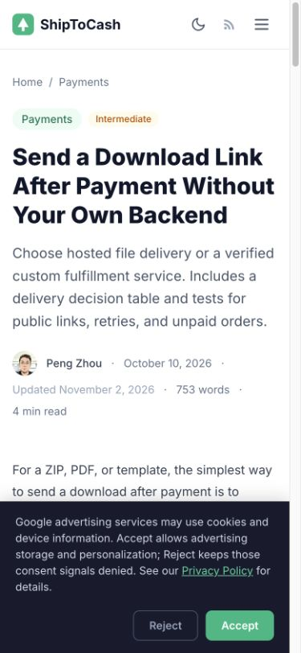

# AdSense 复审前整改记录 — 2026-11-02

## 已完成的内容修改

保留 32 个原有文章网址。11 篇进行了全文重写，其余 21 篇进行了针对性纠错。

全文重写：AdSense 拒审、Astro AdSense 配置、LLC、首批客户、文件交付、托管对比、Stripe 不支持地区、Ko-fi/PayPal、域名转移、模板定价、MoR 与支付处理商。

- 去除无法在仓库中证实的客户对话、个人上线/收入/付款故事及未记录的测试断言；计算改为明确标注的假设示例。
- 修复文件交付建议：不能在校验临时 token 后跳转到永久公开 ZIP；区分托管文件与自建私有交付。
- 修复 Astro 外部脚本处理说明：async 属性本身已使脚本不被处理，不能断言缺少 is:inline 必然导致打包失败。
- 修复 Astro 按需端点说明，补充适配器与运行时区别。签名示例明确不等于完整生产履约逻辑。
- Lemon.js 使用官方 Refresh 方法和当前文档网址。
- 移除旧套餐对比、固定域名价格和虚构市场价格结论；补充决策表、可复现排查方法和官方参考。
- 澄清域名注册转移与 nameserver 迁移，避免断言每次转移必然破坏邮件。
- 删除“每篇都已在自己的项目测试”的全站承诺，补充内容制作、AI 辅助、编辑日期和纠错标准。
- 更新隐私说明以反映当前 GA 未配置、AdSense loader、localStorage 和浏览器内计算。
- 移除无对应手动广告单元的空 adsbygoogle.push；保留审核需要的 publisher loader 和 ads.txt。
- 更新变更标题的 11 张 OG 图。
- 修复手机端文章元信息挤压与宽表格撑开页面。

## 验证结果

- `npm run build` 通过：42 个 HTML 页面。
- `python3 scripts/check-site.py` 通过：2093 处站内链接与资源引用、312 处锚点；canonical、OG 图、单一 H1、文章/面包屑/FAQ JSON-LD 检查无错误。
- Sitemap 与全部 42 页一致；32 篇标题不超过 70 字符、描述不超过 160 字符，均有至少两条外部参考。
- 对文章中的 76 个不同外部参考进行请求检查。发现两条 404，已替换为官方当前网址；Ko-fi 帮助中心和 DNS 检测网站有访问限制，不能把其 403 解释为已确认失效。部分官方链接返回重定向。
- 已在浏览器查看整改文章、作者页与手机端下载交付文章；390px 视口下正文不再撑宽页面。
- `git diff --check` 通过。

## 维护方式

见 [编辑检查表](editorial-checklist.md)。构建后运行 `python3 scripts/check-site.py`。

本次检查不包含真实账户开户、生产付款、提现或个别卖家的法律税务结论。修改没有创造这些经历，也不表示全站每个厂商后台步骤都已重新实测。不能保证 Google 的审核结果。

## 上线及再次申请顺序

1. 按仓库推送要求，由站长确认推送；Cloudflare Pages 随推送部署。
2. 部署后检查公开首页、作者页、整改文章、ads.txt、robots.txt 和 sitemap。不要仅凭本地构建判断上线完成。
3. 在 Search Console 检查抓取与页面可访问情况；收录不是 AdSense 通过保证，也没有必要虚构固定等待期。
4. 登录 AdSense 网站条目，按实际审核提示确认问题已处理并申请复审；保存提交时间与结果。
5. 若再次被拒，结合具体反馈和实际访问数据继续判断，不通过添加篇数或堆字保证通过。

## 参考依据

- [Google 账户未获批说明](https://support.google.com/adsense/answer/81904?hl=en)
- [Google 网站尚未准备好投放广告](https://support.google.com/adsense/answer/12176698?hl=en)
- [Astro 脚本处理](https://docs.astro.build/en/guides/client-side-scripts/)
- [Lemon.js 方法](https://docs.lemonsqueezy.com/help/lemonjs/methods)

## 手机端预览

## 可复现案例补充

- 独立公开仓库：[shiptocash-verification-labs](https://github.com/zhoupeng20188/shiptocash-verification-labs)。
- 固定引用提交：`6537765e7d9493673e744602e388f5cd06b7a2c9`。
- 实验版本：Node 22.23.4、Astro 7.4.4、Node adapter 11.1.9；与内容网站的 Astro 5 依赖分开。
- 干净 npm ci 后本地 45/45 实际 HTTP/SQLite 检查通过；另行验证交互式 demo/send/link/refund 命令成功。
- 参考运行 UTC 时间：2026-11-02T02:23:40.525Z；源码 SHA-256 清单与输出在 lab 仓库 evidence/ 中。
- GitHub 已核实远端提交、源码、证据及 workflow；[Linux CI](https://github.com/zhoupeng20188/shiptocash-verification-labs/actions/runs/41377598098) completed / success。
- 已将 Webhook 与文件交付两篇文章改为带复现命令、实测结果、失败案例及适用边界的案例文章，并从首页和 About 提供入口。
- 内容网站仍待站长单独确认推送上线。公开 lab 已发布，文章改动尚未部署。

后续复查也纠正了环境变量文章残留的虚构截图指代及“构建使用的值必然公开”的错误概括。第三个环境变量 lab 尚未实现，文章不声称已有该实验。

实验文章集成后的最终站点检查：42 页、2095 处本地链接与资源引用、313 处锚点，未发现错误；两篇案例在 390px 视口下无整页横向溢出。
